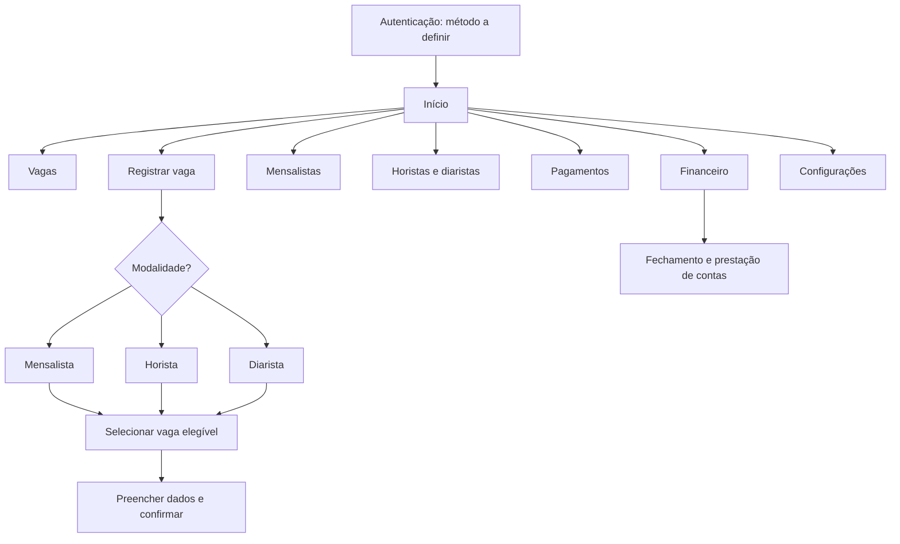

# Navegação proposta

> **A tela inicial ainda não foi escolhida.** Alternativas em avaliação: lista de vagas em destaque, painel misto ou ações rápidas em destaque. O menu também não está definido.

## Estado

Navegação e tela inicial ainda não foram aprovadas pelo cliente.
