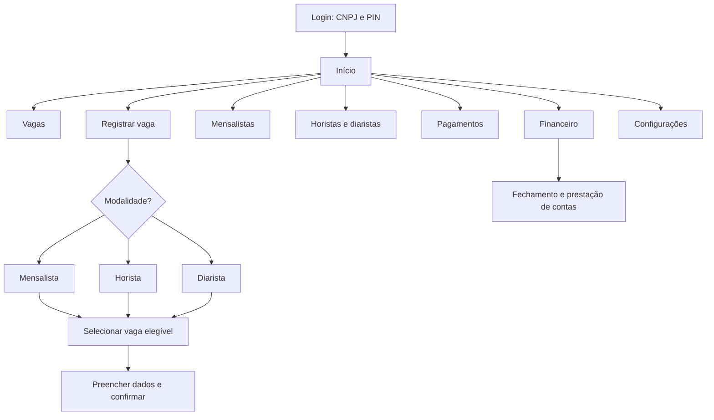

# Fluxos do usuário e mapa de telas

**Público principal:** José, operador com pouca familiaridade digital. O sistema deve priorizar linguagem simples, boa visibilidade e ações frequentes acessíveis em poucos passos.

## Mapa de navegação proposto

> **A tela inicial ainda não foi escolhida.** Alternativas em avaliação: lista de vagas em destaque, painel misto ou ações rápidas em destaque. O menu também não está definido.

## Fluxo 1 — Cadastrar mensalista

1. José seleciona **Registrar vaga > Mensalista**.
2. O sistema mostra somente vagas destinadas a mensalistas disponíveis para contratação.
3. José escolhe uma vaga e localiza ou cadastra o cliente.
4. Informa modalidade, valor aplicável e dia de vencimento.
5. Confirma o vínculo de vaga fixa e contrato.
6. O sistema passa a gerar cobranças mensais para o contrato ativo.

## Fluxo 2 — Registrar entrada de horista

1. José seleciona **Registrar vaga > Horista**.
2. O sistema mostra somente vagas avulsas livres.
3. José seleciona a vaga e informa a placa.
4. Data e hora de entrada são preenchidas automaticamente (edição manual é proposta, não confirmada).
5. José confirma a entrada; a vaga fica ocupada.

## Fluxo 3 — Registrar saída de horista

1. José abre a lista de permanências ativas.
2. Seleciona o veículo e clica em **Registrar saída**.
3. O sistema calcula o tempo e o valor em frações iniciadas de 30 minutos.
4. A confirmação do pagamento e o momento exato da liberação da vaga **ainda precisam ser definidos**.

## Fluxo 4 — Registrar diarista

1. José seleciona **Registrar vaga > Diarista**.
2. Seleciona uma vaga avulsa livre.
3. Informa placa e registra o pagamento antecipado de R$ 28.
4. O sistema registra a permanência; validade e renovação da diária **a confirmar**.

## Fluxo 5 — Registrar pagamento mensal

1. José localiza o cliente por nome ou CPF.
2. Seleciona a cobrança e clica em **Registrar pagamento**.
3. Confirma a forma de pagamento e o recebimento.
4. O sistema atualiza a situação da cobrança e o histórico.
5. Se houver data excepcionalmente combinada, a alteração deve ficar registrada.

## Fluxo 6 — Fechar o mês e prestar contas

1. José abre **Financeiro > Fechamento mensal**.
2. Confere previstos, recebidos, pendentes e atrasados.
3. O sistema calcula os 50% de Marcos conforme a base validada.
4. José registra o repasse por PIX.
5. Exporta PDF, Excel ou versão para impressão.
6. Correções posteriores exigem trilha de auditoria.

## Diretrizes de interface

- Texto legível, contraste adequado, campos e botões amplos.
- Ações com verbos claros: **Registrar entrada**, **Registrar saída**, **Registrar pagamento**.
- Mostrar estado da vaga por texto e cor.
- Mensagens de confirmação e prevenção de operações duplicadas.
- Preservar o contexto quando o usuário navega entre listas e formulários.
- Indicar claramente quando o dispositivo estiver offline e quando houver sincronização pendente.

## Protótipo

Wireframes e telas de alta fidelidade ainda não foram finalizados. Capturas de tela serão adicionadas quando produzidas.
