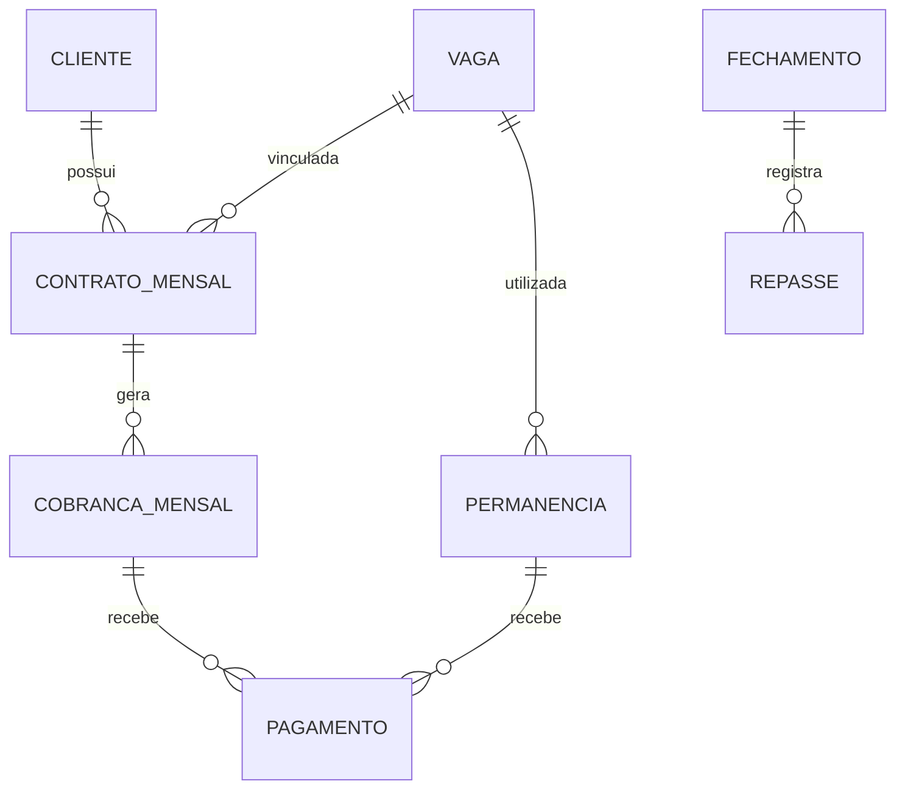

# Modelagem preliminar de dados

> Proposta conceitual, **não** um esquema de banco de dados implementado. Nomes, tipos e cardinalidades serão revisados antes da implementação.

## Entidades propostas

| Entidade | Campos principais | Observações |
| --- | --- | --- |
| Estacionamento | id, cnpj, nome | Identificação da operação; dados sensíveis protegidos |
| Operador | id, estacionamento_id, identificador, credencial_hash | Não armazenar PIN em texto puro |
| Cliente | id, nome, cpf, telefone, observacoes, criado_em, ativo | CPF deve ser protegido e validado |
| Vaga | id, codigo, uso_permitido, cobertura, categoria_preco, ativa | Uso mensalista ou avulso |
| ContratoMensal | id, cliente_id, vaga_id, modalidade, valor, dia_vencimento, inicio, fim, status | Uma vaga não pode ter contratos ativos conflitantes |
| CobrancaMensal | id, contrato_id, competencia, valor_previsto, vencimento_original, vencimento_acordado, status | Evitar duplicação por contrato/competência |
| Pagamento | id, cobranca_id?, permanencia_id?, valor, meio, recebido_em | Relação com cobrança ou permanência; pagamento parcial pendente |
| Permanencia | id, vaga_id, modalidade_avulsa, placa, entrada_em, saida_em, valor_calculado, status | Horista ou diarista; duração da diária pendente |
| Fechamento | id, competencia, previsto, recebido, pendente, valor_marcos, status, fechado_em | Cálculos devem ser rastreáveis |
| Repasse | id, fechamento_id, valor, data, meio, referencia | PIX como meio confirmado |
| Auditoria | id, entidade, registro_id, acao, antes, depois, realizado_em, operador_id | Cuidados com dados pessoais no log |

## Relacionamentos previstos

## Restrições relevantes

- A vaga tem **modalidade permitida** independente de estar fisicamente livre.
- Não permitir contratos mensais ativos sobrepostos na mesma vaga.
- Não permitir permanências avulsas simultâneas na mesma vaga.
- Registrar data/hora de entrada e saída com tratamento consistente de fuso horário.
- Guardar valores monetários em centavos inteiros ou tipo decimal exato, não ponto flutuante.
- Preservar valores históricos das cobranças mesmo após reajuste de tarifas.
- Definir mecanismo de idempotência para sincronização offline e geração automática de cobranças.
- Evitar registrar CPF, PIN e dados pessoais desnecessários em logs.

## Decisões técnicas pendentes

Banco de dados, backend, frontend, infraestrutura, política de backup, sincronização offline, autenticação e estratégia de conflitos ainda não foram escolhidos.
